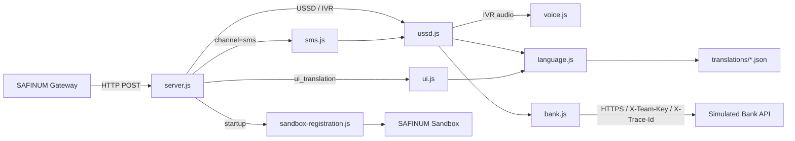
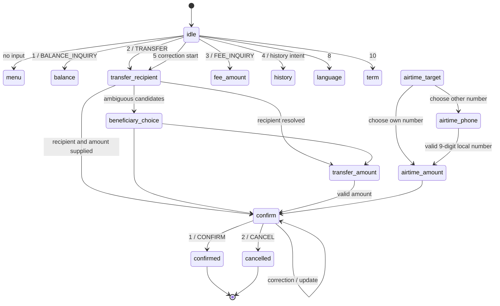

# Yare Linguistic Layer — Technical & Architectural Documentation

## 1. Executive summary

Yare Linguistic Layer is a dependency-free Node.js middleware for the SAFINUM 2026 sandbox challenge. It receives channel requests from a SAFINUM gateway, applies a small linguistic/NLU layer, coordinates stateful banking journeys, calls the simulated banking API, and returns gateway-compatible JSON responses.

The service supports:

- **USSD** menus and transactional flows;
- **SMS** as a stateless HTTP adapter backed by in-memory sessions derived from the phone number;
- **IVR** audio turns using an OpenAI-compatible speech-to-text endpoint;
- **Mobile and web UI** string translation;
- **ATM UI** translation, but not ATM transactions;
- **Automatic registration** of one public endpoint with the SAFINUM sandbox;
- **French, English, Hausa, Ewondo, Fulfulde, and Kamtok** dictionaries.

The runtime entry point is `server.js`. There is no application framework or external npm dependency. The project requires Node.js 18 or newer because it uses global `fetch`, `FormData`, `Blob`, `AbortSignal.timeout`, and built-in modules.

## 2. Repository map

| Path | Responsibility |
|---|---|
| `server.js` | HTTP server, request routing, trace-ID extraction, basic logging, and startup registration |
| `env.js` | Minimal `.env` loader using built-in Node modules |
| `bank.js` | HTTP client for the simulated banking API |
| `language.js` | Text normalization, intent parsing, language preference, and USSD/UI localization helpers |
| `ussd.js` | Main state machine and banking journeys for USSD and SMS |
| `sms.js` | SMS request adaptation and segment accounting |
| `voice.js` | IVR audio-to-text integration |
| `ui.js` | Mobile, web, and ATM UI translation |
| `sandbox-registration.js` | Registration of channels with the SAFINUM sandbox |
| `translations/*.json` | Localized UI and USSD dictionaries |
| `samples/*.json` | Example gateway payloads |
| `.env.example` | Environment variable template |
| `render.yaml` | Render deployment blueprint |
| `README.md` | Challenge setup and operating instructions |
| `package.json` | Node metadata and start command |

## 3. System architecture



### Architectural style

The project is a small modular monolith:

1. **HTTP transport/adaptation** — `server.js`, `sms.js`, `voice.js`;
2. **Conversation orchestration** — `ussd.js`;
3. **Linguistic/NLU utilities** — `language.js`;
4. **Domain API integration** — `bank.js`;
5. **Screen localization** — `ui.js`;
6. **Infrastructure configuration** — `env.js` and `sandbox-registration.js`.

It intentionally uses plain CommonJS modules and in-memory state to minimize setup. This makes the project easy to run, but not horizontally scalable or durable.

## 4. Runtime entry point and HTTP contract

### Startup

Running `npm start` or `node server.js`:

1. Loads `.env` with `loadEnv()`;
2. Creates a native HTTP server;
3. Uses `PORT` or port `8080`;
4. Optionally registers public endpoints if `SAFINUM_AUTO_REGISTER=true`.

### GET `/` and `/health`

Any GET request receives:

```json
{"ok":true,"service":"safinum-starter-node"}
```

`render.yaml` uses `/health` for Render health checks. The current implementation does not match `/health` specially; it handles every GET identically, so `/health` works only as an availability probe and does not provide dependency health information.

### POST routing

After reading and parsing the complete JSON body:

- `payload.type === "ui_translation"` → `handleUi(payload)`;
- `payload.channel` or `payload.type` normalized to `sms` → `handleSms(payload, traceId)`;
- every other request → `handleUssd(payload, traceId)`.

The `X-Trace-Id` header takes precedence over `payload.trace_id`. It is forwarded to every banking API call made during that turn.

Most successful requests return HTTP 200. Invalid JSON returns 400. Errors with `statusCode === 400` return 400; all other application exceptions return 500.

## 5. Session and state model

USSD state is stored in a process-local `Map` in `ussd.js`, keyed by `session_id`.

Typical state fields include:

- `step`: current conversation stage;
- `operation`: transfer or airtime;
- `language` / `gatewayLanguage` / `languageOverride`;
- `menuPage`;
- `amount`, `fee`, `total`;
- `to`, `recipientName`, `reference`;
- beneficiary candidates and pending correction data.

The base session state is `{ step: 'idle' }`. Sessions are deleted whenever `response.end_session` is true.

SMS creates a deterministic, per-number session key:

1. Generate a random process-level 32-byte salt;
2. Hash the salt + null separator + normalized/trimmed phone number with SHA-256;
3. Use `sms-${digest}` as the USSD session ID.

Consequently, SMS context is retained only within the same Node process and for a different session key from USSD.

Language preferences are also process-local, keyed by digits-only phone number. UI and conversation code share this map.

### State limitations

- Lost on process restart or redeployment;
- Not shared across horizontal replicas;
- Not externally observable or persistent;
- SMS isolation depends on the process lifetime of `sessionSalt`;
- Missing `session_id` on USSD means all turns use `sans-session`, creating one shared fallback session.

Production hardening should use Redis or another distributed store for both conversation state and language preference.

## 6. USSD and conversation state machine

### Input normalization

`readUssdInput()` prefers `input.text` and falls back to `input.ussd_text`. It also extracts the final segment from USSD strings containing `*` or `#`, and treats an input ending in `#` as empty.

Arabic-Indic numerals are normalized by `understand()`.

### Menu

The main menu contains:

1. Balance inquiry;
2. Transfer;
3. Fee inquiry;
4. Transaction history;
5. Correction;
6. Ambiguous clarification;
7. Insufficient-funds scenario;
8. Language;
9. Other channel;
10. Financial terminology.

Menu page 2 is selected with `00`.

### Intent parsing

`language.js.parseInput()` parses normalized free text into official-style intents:

- `BALANCE_INQUIRY`
- `TRANSFER`
- `AIRTIME_PURCHASE`
- `FEE_INQUIRY`
- `TRANSACTION_HISTORY`
- `TERM_EXPLANATION`
- `LANGUAGE_SWITCH`
- `CORRECTION`
- `CONFIRM`
- `CANCEL`
- `CLARIFICATION_NEEDED` or `UNKNOWN`

It also extracts positive numeric amounts and beneficiary phone names/numbers. Numeric choices `1`–`7` receive a `choice` field instead of an intent.

Supported languages are identified through aliases in `languageCode()`:

| Code | Language | IVR hint |
|---|---|---|
| `fr` | French | `fr` |
| `en` | English | `en` |
| `hau` | Hausa | `ha` |
| `ewo` | Ewondo | `fr` |
| `fub` | Fulfulde | `ff` |
| `wes` | Kamtok | `en` |

### Main stages



Not every menu item is a distinct domain flow. Items 5 and 7 are scenario-oriented entry points that begin a transfer. Corrections are primarily handled after a pending transaction has been created.

### Balance

`GET /accounts/{phone}`. The displayed balance comes from `result.data.balance` and is treated as FCFA.

### Transaction history

`GET /accounts/{phone}/transactions?limit=5`. The implementation accepts several response shapes:

- top-level array;
- `{ transactions: [...] }`;
- `{ history: [...] }`;
- `{ items: [...] }`;
- nested `data.transactions` or `data.history`.

It shows at most three entries and translates transaction type/status in the active language.

### Fee inquiry

Prompts for an amount, calls `GET /fees?type=transfer&amount={amount}`, and validates `fee` and `total` fields. A successful inquiry ends the session.

### Transfer flow

1. Select or resolve the beneficiary.
2. Direct 9-digit or `237` phone numbers bypass beneficiary lookup.
3. Names invoke `GET /beneficiaries?q={name}&phone={ownPhone}`.
4. If candidates are ambiguous, the user chooses a numbered candidate.
5. If a valid amount is present, create a pending transfer immediately; otherwise ask for the amount.
6. `POST /transactions` creates a pending transaction.
7. Show a separate confirmation review.
8. Confirm with `POST /transactions/{reference}/confirm` or cancel with `POST /transactions/{reference}/cancel`.

### Airtime flow

1. Choose own number or enter another number.
2. Validate the target using Cameroon local-number rules.
3. Prompt for the amount.
4. `POST /transactions` creates a pending airtime transaction.
5. Show a separate confirmation review.
6. Confirm or cancel in the next turn.

### Corrections

While in `confirm`, text containing a correction intent enters `correctPending()`. Corrections can update:

- the amount; or
- the beneficiary name/phone.

Ambiguous corrected beneficiaries are presented for numbered selection. Corrections call `POST /transactions/{reference}/update`; the pending review is re-rendered and still requires separate confirmation.

## 7. Banking API client

`createBank(baseUrl, traceId)` builds a client from:

- `payload.bank_api.base_url` first; or
- `SAFINUM_BANK_URL` fallback.

All calls send:

- `Accept: application/json`;
- `Content-Type: application/json`;
- `X-Team-Key: SAFINUM_TEAM_KEY`;
- `X-Trace-Id` when available.

The client uses a 2.5-second timeout. Failures are converted into a structured result rather than thrown:

```json
{"ok":false,"status":0,"data":{"error":"UNREACHABLE","message":"..."}}
```

| Method | Path |
|---|---|
| Balance | `GET /accounts/{phone}` |
| History | `GET /accounts/{phone}/transactions?limit={limit}` |
| Fees | `GET /fees?type={type}&amount={amount}` |
| Beneficiaries | `GET /beneficiaries?q={query}&phone={phone}` |
| Create | `POST /transactions` |
| Update | `POST /transactions/{reference}/update` |
| Confirm | `POST /transactions/{reference}/confirm` |
| Cancel | `POST /transactions/{reference}/cancel` |

Phone and path parameters are URL-encoded.

## 8. SMS architecture

SMS uses `handleUssd()` so banking and language behavior remain shared with USSD. `handleSms()`:

- requires `phone`;
- accepts message text from `input.text`, `message`, or `text`;
- creates a hashed phone-keyed session ID;
- injects `input.type = 'text'`;
- returns the standard USSD-style response object;
- calculates and logs segment usage.

Segment accounting is informational only:

- GSM-7 single segment: 160 units;
- GSM-7 concatenated segment: 153 units;
- UCS-2 single segment: 70 units;
- UCS-2 concatenated segment: 67 units;
- GSM-7 extended characters count as two units;
- non-GSM-7 text is counted as UCS-2.

The implementation does not truncate SMS responses.

## 9. IVR architecture

For IVR payloads, `channel === "ivr"` and `input.type === "audio"`, `ussd.js` sends base64 WAV data to `transcribe()` before normal routing.

The STT integration expects an OpenAI-compatible endpoint:

- default URL: `https://api.openai.com/v1`;
- default model: `whisper-1`;
- endpoint: `/audio/transcriptions`;
- auth: `Authorization: Bearer VOICE_STT_API_KEY` or `OPENAI_API_KEY`;
- timeout: `VOICE_STT_TIMEOUT_MS`, default 6500 ms.

Supported audio format is exactly base64-encoded WAV. Language hints are mapped to STT language codes. Transcription failures return a French clarification, with the final language produced through `say()` and the declared language determined by the translation result.

## 10. Localization architecture

### Dictionaries

USSD and UI strings are stored in JSON translation dictionaries under `translations/`.

Languages currently shipped:

- `fr.json` is not present; French is the source-language fallback;
- `en.json`;
- `ewo.json`;
- `fub.json`;
- `hau.json`;
- `wes.json`.

Dictionaries are loaded synchronously and cached neither in UI nor in language modules. For USSD, changes can be visible on the next request. `UI` loading is repeated per request.

### USSD translation

The USSD engine creates French source strings and calls `say(text, language)` before response construction is returned to the gateway.

`say()`:

1. maps the source phrase to a dictionary key;
2. loads the requested dictionary;
3. substitutes named placeholders;
4. returns the translated language if a translation exists;
5. otherwise retains French and declares `fr`.

Dynamic templates support placeholders such as `{amount}`, `{recipient}`, `{fee}`, `{total}`, `{reference}`, and `{count}`.

### UI translation

`handleUi()` expects `payload.strings` to be a keyed object of source entries. It emits only keys found as non-empty strings in the selected dictionary.

Missing translations are omitted. According to the challenge contract, the gateway may then display source French text. Unsupported or malformed languages result in French fallback and `language: "fr"`.

Before sending, UI translation checks:

- placeholder consistency;
- `max_chars` limits.

These checks currently only log warnings. They do not prevent a response or truncate text.

## 11. Sandbox endpoint registration

At startup, when automatic registration is enabled, `registerSandboxEndpoints()`:

1. Reads `SAFINUM_TEAM_KEY`;
2. Uses `RENDER_EXTERNAL_URL` or `SAFINUM_PUBLIC_URL`;
3. validates both public and registration URLs are HTTPS;
4. parses `SAFINUM_CHANNELS`;
5. registers each channel at `SAFINUM_REGISTRATION_URL`;
6. retries each channel three times with 1-second and 2-second backoff.

Default channels:

- `ussd`;
- `mobile`;
- `web`;
- `sms`;
- `ivr`;
- `atm`.

The registration payload is:

```json
{"channel":"ussd","url":"https://service.example.com"}
```

Authorization uses `X-Team-Key`.

## 12. Configuration

| Variable | Purpose | Default |
|---|---|---|
| `SAFINUM_TEAM_KEY` | Bank/sandbox team authentication | none |
| `PORT` | HTTP listen port | `8080` |
| `SAFINUM_BANK_URL` | Banking API fallback base URL | none |
| `SAFINUM_AUTO_REGISTER` | Enable startup registration | `false` |
| `SAFINUM_CHANNELS` | Comma-separated sandbox channels | all channels |
| `SAFINUM_REGISTRATION_URL` | Sandbox endpoint registration URL | SAFINUM endpoint |
| `SAFINUM_PUBLIC_URL` | Public HTTPS service URL | none |
| `RENDER_EXTERNAL_URL` | Render-provided public URL | environment-provided |
| `VOICE_STT_API_KEY` | IVR STT API key | none |
| `OPENAI_API_KEY` | Alternate STT API key | none |
| `VOICE_STT_URL` | STT base URL | `https://api.openai.com/v1` |
| `VOICE_STT_MODEL` | STT model | `whisper-1` |
| `VOICE_STT_TIMEOUT_MS` | STT timeout | `6500` |

Variables already present in the process are not overwritten by `.env`.

## 13. Deployment architecture

`render.yaml` creates one Node web service:

- region: Frankfurt;
- build command: `npm install`;
- start command: `npm start`;
- health path: `/health`;
- secret: `SAFINUM_TEAM_KEY`;
- automatic sandbox registration enabled;
- all supported channels declared.

Render deploys the service with a public HTTPS URL, and the startup registration uses `RENDER_EXTERNAL_URL`.

### Deployment constraints

- Keep a single instance for challenge/demonstration reliability;
- Do not scale horizontally without externalizing sessions;
- Avoid spin-down or cold-start delays in live demos;
- Restrict bank and STT credentials as deployment secrets;
- There is no HTTPS termination or auth inside `server.js`; public exposure is expected behind Render/tunnels.

## 14. Request/response examples

### USSD menu

```json
{
  "session_id": "demo-1",
  "phone": "237690000000",
  "language": null,
  "input": { "type": "text", "text": "", "ussd_text": "" },
  "bank_api": { "base_url": "https://safinum.cm/api/v1" }
}
```

Response shape:

```json
{
  "response": { "text": "...", "end_session": false, "options": [] },
  "interpretation": { "intent": "UNKNOWN", "parameters": {}, "language": "fr" },
  "transaction": { "id": null, "status": "none" }
}
```

### Pending transaction

A pending response is produced after `createTransaction`, not after confirmation:

```json
{
  "response": { "text": "...", "end_session": false, "options": ["Confirmer", "Annuler"] },
  "interpretation": { "intent": "TRANSFER", "parameters": {}, "language": "fr" },
  "transaction": { "id": "transaction-reference", "status": "pending" }
}
```

Confirmation is a separate turn and finalizes the transaction.

### UI translation

Input:

```json
{
  "type": "ui_translation",
  "channel": "mobile",
  "phone": "237690000000",
  "language": "en",
  "strings": {
    "common.cancel": { "text": "Annuler", "context": "Button", "max_chars": 20 }
  }
}
```

Output:

```json
{
  "language": "en",
  "strings": { "common.cancel": "Cancel" }
}
```

## 15. Error handling

### Transport errors

- malformed JSON: 400;
- unsupported HTTP method: 405;
- SMS missing phone or text: 400;
- invalid JSON: 400;
- unexpected exceptions: 500.

### Banking errors

`bankError()` maps sandbox error codes to localized French source text:

- `INSUFFICIENT_FUNDS`;
- `INVALID_AMOUNT`;
- `LIMIT_EXCEEDED`;
- `UNKNOWN_BENEFICIARY`;
- `AMBIGUOUS_BENEFICIARY`;
- `UNKNOWN_BILLER`;
- `UNKNOWN_ACCOUNT`;
- `TX_NOT_FOUND`;
- `TX_NOT_PENDING`;
- `INVALID_REQUEST`;
- `INVALID_RESPONSE`;
- `UNREACHABLE`.

Unknown codes return a generic failure.

### Traceability

`X-Trace-Id` is captured from the HTTP header or payload and forwarded to every bank call. Traceability for STT and sandbox registration uses ordinary logs rather than the banking trace header.

## 16. Channel constraints

### USSD

- target response length: 182 characters;
- target alphabet: GSM-7;
- current implementation warns but does not truncate or hard-enforce constraints;
- translation keys must remain within 182 characters and avoid unsupported network characters.

### SMS

- independent turns are supported;
- session state is retained by phone number;
- segment count is logged;
- response text is never truncated;
- UCS-2 triggers for characters outside GSM-7.

### UI

- placeholders must remain intact;
- `max_chars` should be respected;
- missing keys should fall back to French through gateway behavior;
- unsupported languages should honestly declare `fr`.

## 17. Logging and observability

The service logs:

- incoming sanitized USSD/SMS payload metadata;
- scenario fields detected in payloads;
- outgoing USSD/SMS response bodies;
- bank configuration and API errors;
- STT failures;
- SMS encoding and segment counts;
- missing or overlong UI translations;
- sandbox registration progress and retries.

It does not currently include structured logging, metrics, request duration metrics, health checks for external dependencies, or a persistent audit log.

## 18. Security considerations

- `.env` and environment secrets are excluded by `.gitignore`;
- team key is sent only as `X-Team-Key` and never placed in `render.yaml`;
- incoming payloads are sanitized before payload logging by `sanitizePayload()`;
- no authentication middleware validates gateway requests;
- no per-request origin allowlist or replay protection exists;
- SMS sessions are random-hash keyed and not exposed as raw phone numbers;
- JSON and HTTP inputs are not placed in SQL or shell commands;
- base URL construction assumes a valid trusted bank API URL;
- external service calls use `AbortSignal.timeout` to limit waits.

For production, the service should add gateway signature verification, secret rotation, rate limiting, structured audit logs, and allowlisted bank/STT hosts.

## 19. Known technical constraints and improvement areas

1. **In-memory state** must be replaced for multiple replicas or restarts.
2. **No French dictionary file** is required because French is the in-code source fallback.
3. **GSM-7/UI constraints are warnings only** and are not enforced before response delivery.
4. **Health endpoint is not dependency-aware**.
5. **No npm dependencies** means no framework-level security, validation, or middleware facilities.
6. **Payload validation is shallow** and primarily handled at field-usage time.
7. **SMS session salt is process-specific** and not recoverable after restart.
8. **USSD `sans-session` fallback** may merge users when the gateway omits `session_id`.
9. **No persistent language preference** survives restarts.
10. **Scenario detection inspects arbitrary payload fields** for names or labels containing scenario keywords.
11. **UI missing strings are omitted** rather than explicitly replaced with French entries.
12. **Voice STT requires Node 18+ plus network access**.
13. **One confirmation design** exists for transfer and airtime but does not cover every menu scenario.
14. **The code does not implement ATM transaction state machines**; ATM is only registered for translation.

## 20. Extension guide

### Add a language

1. Add `translations/{code}.json`.
2. Add language aliases to `language.js`.
3. Add menu/text keys and dynamic templates.
4. Add voice STT hint mapping in `voice.js` if IVR support is needed.
5. Add the language to the language-selection menu.

### Add a USSD intent

1. Parse the intent in `language.js.parseInput()`.
2. Route it in `ussd.js.route()` or `handleMenu()`.
3. Implement the conversation stage and bank calls.
4. Add both static/dynamic French source matching and all translation keys.
5. Ensure the session reaches `end_session: true` or remains at an intentional next step.

### Add a banking operation

1. Add a method to `bank.js`.
2. Keep `X-Trace-Id` propagation centralized in `createBank()`.
3. Map API error codes in `bankError()`.
4. Create a pending/confirm/cancel state only if the operation is destructive or financial.
5. Add localized source phrases and intents.

### Externalize state

Replace `sessions` and `languagePreferences` with a shared store interface exposing:

- `getSession(sessionId)`;
- `setSession(sessionId, state, ttl)`;
- `deleteSession(sessionId)`;
- `getLanguage(phone)`;
- `setLanguage(phone, code, ttl)`.

The SMS session-key scheme and `handleUssd()` interface can remain unchanged.
